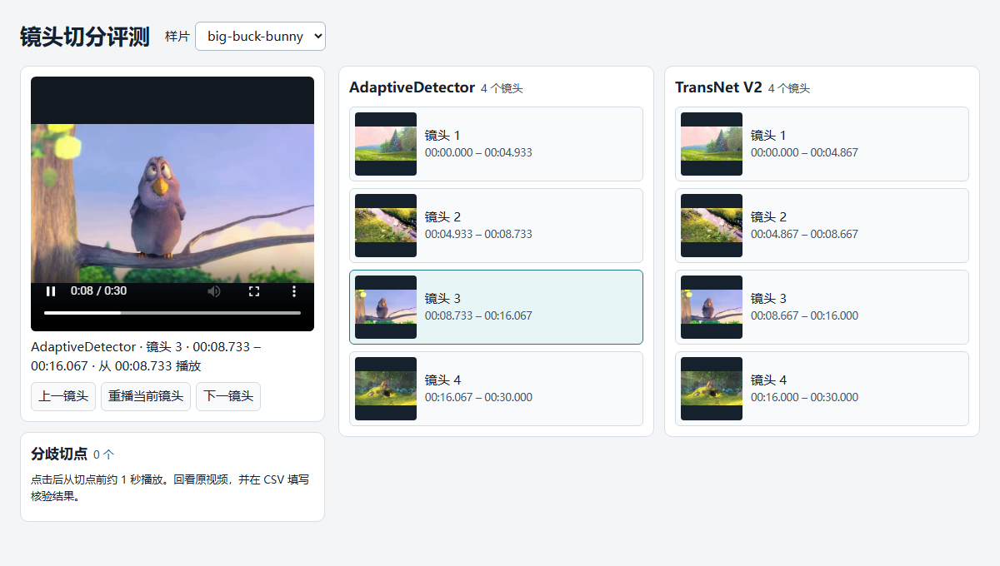

# Short Video Shot Detection

## 项目简介

基于传统视觉算法与预训练深度学习模型的短视频镜头切分工具。

支持批量检测镜头边界，自动生成每个镜头的**起止时间、预览图和结构化 JSON**，为后续素材打标、检索与重新组合提供基础。

## 设计思路

### 1. 任务理解与技术考量

考虑到本次任务的视频规模较小、交付周期有限，方案优先满足以下要求：

- **检测效果**：能够识别常见硬切，并尽量减少运动、闪光等造成的误检。
- **开发效率**：复用成熟开源实现，不重新训练模型。
- **工程可靠性**：支持批量处理，单条视频失败不影响其他视频。
- **结果可验证**：输出结构化时间区间和预览图，便于检查切分效果。

### 2. 技术方案

采用传统视觉方法与预训练深度学习模型进行独立对照：

| 方法                 | 核心原理                                       | 定位                         |
| -------------------- | ---------------------------------------------- | ---------------------------- |
| **AdaptiveDetector** | 根据帧间视觉内容差异及局部变化统计判断镜头切换 | 默认方案，轻量、无需模型权重 |
| **TransNet V2**      | 使用神经网络学习视频帧序列中的转场特征         | 可选方案，补充时序建模能力   |

两个检测器使用统一的批处理与输出流程，生成镜头起止时间及对应预览图。

**默认使用部署成本较低的 AdaptiveDetector**，并保留 TransNet V2 供独立对照。

### 3. 输入差异与异常处理

程序通过 OpenCV 后端读取视频，不要求输入具有固定分辨率或帧率。TransNet V2 在推理前将视频帧缩放至模型要求的尺寸。

批处理逐条执行，并对每条视频独立捕获异常：

- **输入差异**：读取视频实际帧率和时间信息，按统一格式输出镜头区间。
- **处理失败**：视频无法打开、解码失败或结果生成失败时，记录对应文件及错误原因。
- **失败隔离**：单条视频失败不会中断批次，程序继续处理剩余视频，并在结束时汇总成功、失败数量。

**真实案例与工程验证。** 官方样片 `sample-01.mp4` 使用 AdaptiveDetector 检出 34 个镜头，前三段为 0–2.333333、2.333333–4.4、4.4–5.8 秒。三条样片在两种检测器下均处理成功，分别输出 100 和 77 个镜头。逐条验证了区间从 0 秒连续覆盖至视频结束，以及每个镜头的 JPEG 可解码。混入损坏 MP4 后，其余视频仍生成结果。

**人工评测与已知问题。** 样片为 15 FPS，AdaptiveDetector 默认最短切点间隔 15 帧（1 秒），会限制密集切点的检出。双算法在 ±3 帧下有 53 个单侧预测，已整理成核查材料，误检、漏检和准确性待人工标注确认。详见[基线实验](docs/baseline-results.md)和[算法对照与人工核查](docs/detector-comparison.md)。

**AI 辅助开发。** [AGENTS.md](AGENTS.md) 的三条规则在交付中有直接作用。

- **Keep It Simple** 复用成熟检测器和同一输出流程，切点核查直接读取已有 JSON。
- **Verify What Matters** 用真实视频检查覆盖范围和预览图，混入损坏文件验证批处理隔离。
- **Keep Delivery Reproducible** 固定依赖和上游代码版本，记录权重校验值，并排除本地素材及运行产物。

## 二、部署运行

### 1. 环境准备

Python ≥ 3.10，安装依赖：

```
pip install -r requirements.txt
```

将待处理的 MP4 视频放入 `data/` 目录。

### 2. 运行检测

**AdaptiveDetector（默认）**

```
python main.py --input-dir data --output-dir outputs/adaptive
```

**TransNet V2（可选）**

先按[部署说明](docs/detector-comparison.md#部署与运行)准备模型依赖与权重，再执行：

```
python main.py --input-dir data --output-dir outputs/transnetv2 --detector transnetv2
```

### 3. 输出结果

每条视频生成独立目录：

```
outputs/adaptive/
└── sample-01/
    ├── shots.json
    ├── shot_0001.jpg
    ├── shot_0002.jpg
    └── ...
```

- `shots.json`：各镜头的起止时间及预览图路径。
- `shot_XXXX.jpg`：对应镜头的预览图。

镜头时间以秒为单位，采用左闭右开区间 `[start, end)`。

> 测试素材不包含在公开仓库中，运行时需自行放入 `data/`。

### 4. 人工评测

用浏览器打开 `outputs/shot-review.html`，在顶部切换三条样片，并排查看两个检测器的镜头区间和预览图。

- **查看镜头**：点击镜头从起点播放，到终点自动暂停。可重播或切换同一检测器的上一镜头、下一镜头。
- **核查切点**：点击分歧切点，从切点前约 1 秒播放原视频。拖动进度条到当前镜头区间外也可恢复普通播放。
- **记录结果**：以原视频为准，按视频名和帧号在 `outputs/cut-review/cut-review.csv` 填写人工标签和备注。



演示素材为 [Big Buck Bunny](https://peach.blender.org/about/) 的 30 秒节选。© 2008 Blender Foundation / www.bigbuckbunny.org，[CC BY 3.0](https://creativecommons.org/licenses/by/3.0/)。
